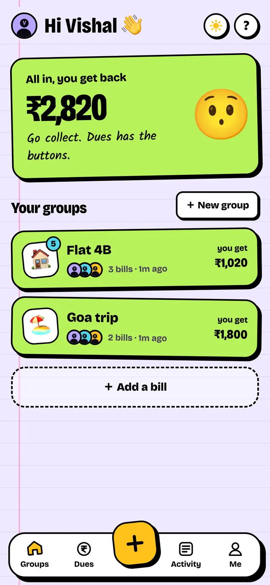
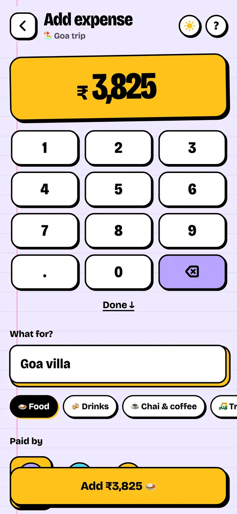
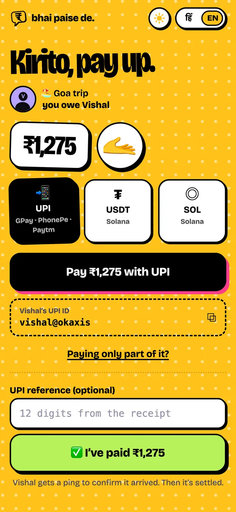
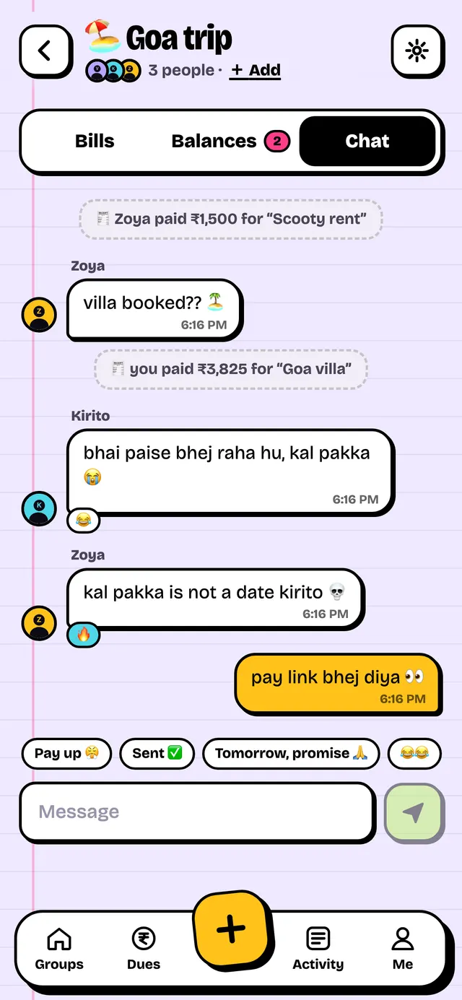
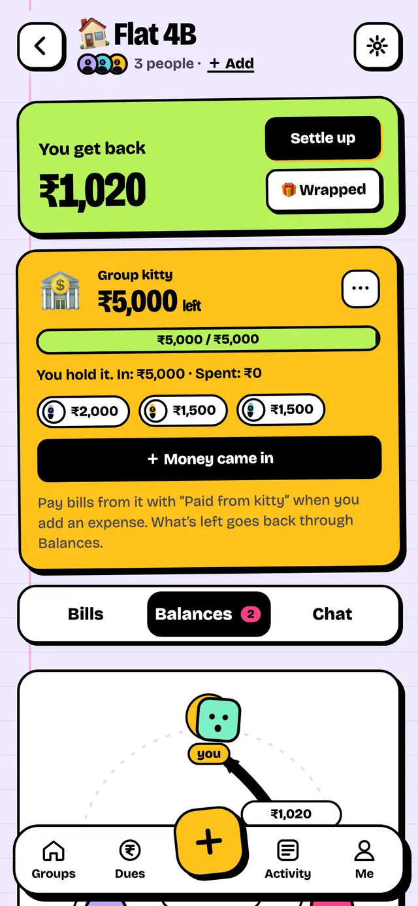
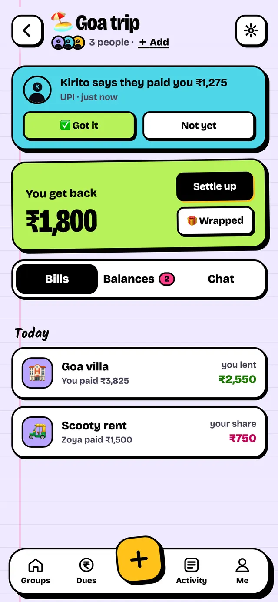
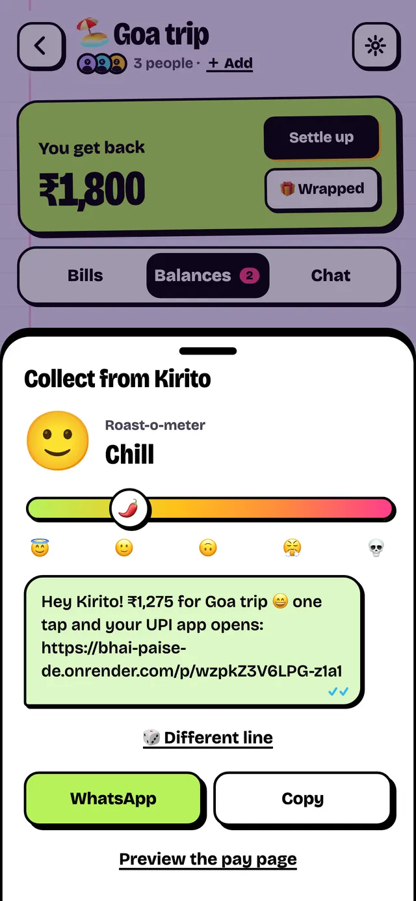
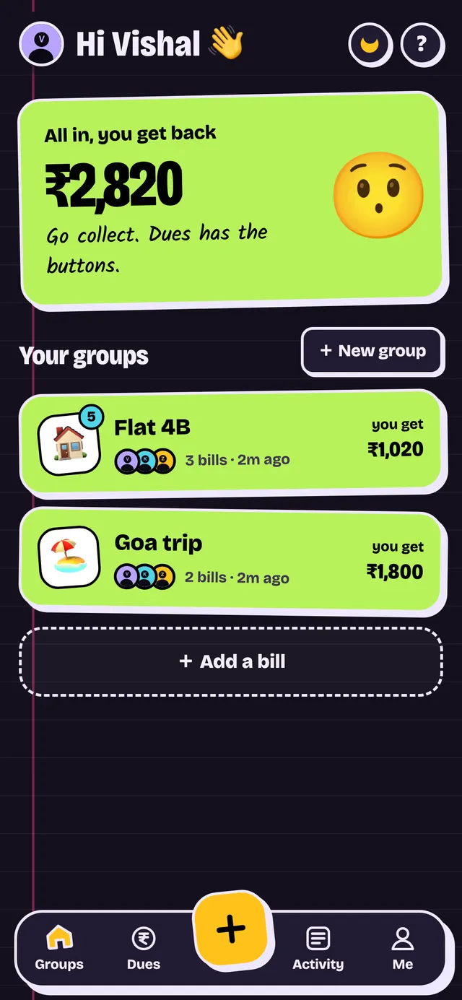

<div align="center">


# Bhai Paise De™

**Split bills with friends, and get paid back by UPI in a tap.**

*"Bro, give money."*


Created by **Vishal Gupta** · [hii.vishalgupta@gmail.com](mailto:hii.vishalgupta@gmail.com)

</div>

---

Most bill splitters tell you Om owes you ₹1,700, then leave you to chase him. **Bhai Paise De** sends Om a link instead. It opens his UPI app (GPay, PhonePe, Paytm…) with your UPI ID and the exact amount already filled in. He pays and taps **"I've paid"**. You get a ping, tap **"Got it"**, and it's settled for everyone, with a receipt in the group chat. Om never has to install anything.

Signing up takes one screen: your name, your UPI ID if you want, done. No email, no phone number, no password. Your account is a key made on your phone, and moving to a new phone is one QR scan.

It's a website that installs like an app (PWA), in English or Hinglish, light or dark.

## Screenshots

| Home | Add a bill | Pay by UPI | Group chat |
| :---: | :---: | :---: | :---: |
|  |  |  |  |

| Kitty | "I've paid" | Roast dial | Dark mode |
| :---: | :---: | :---: | :---: |
|  |  |  |  |

## What makes it different

| | Typical splitter | Bhai Paise De |
| --- | --- | --- |
| Who needs the app | Everyone | Only the person keeping track. Others pay from a link in any browser |
| Getting paid back | "Mark as paid", then go find their UPI ID | The link opens their UPI app with the amount filled in; they say "I've paid", you confirm |
| Signing up | Email or phone, plus a password or OTP | Name and go. The account is a key on your phone |
| New phone | Log in again | Scan a QR from the old phone, or type your 12 backup words |
| Group life | Expenses only | Expenses, group chat, a shared kitty, nudges, repeating bills, PDF statements |
| The record | Their database, editable | Every change is signed by the person who made it and hash-chained, with an encrypted off-site copy anyone in the group can verify |
| Tone | Polite | A sarcasm dial from *Sanskaari* to *Nuclear* on every reminder |

## Features

**Splitting**
- Groups for trips, flats and dinners. Add people by WhatsApp invite link, a QR code, friends already on the app, or just a name.
- Five split modes: equal, exact, shares, percent, and item by item (tax, tip and discount shared in proportion). Amounts are whole paise and always add up.
- Debt simplification to at most n−1 payments, with an animated who-owes-who graph.
- Receipt photos, repeating bills ("Rent is due again — add it?"), CSV export and a printable PDF statement.

**Getting paid**
- **UPI paybacks.** One button on Android, GPay / PhonePe / Paytm buttons on iPhone, a QR code on laptops, and a copyable UPI ID everywhere.
- **"I've paid" → "Got it".** UPI money moves bank to bank and never touches the app, so the person who received it confirms. Only they can.
- **Nudges and roasts.** A friendly push to people on the app (at most twice a day), or a WhatsApp pay link with a sarcasm dial for people who aren't.
- **Group kitty.** One person holds a shared pot, everyone chips in, and bills can be "paid from the kitty".
- **Crypto, optional.** Turn on USDT/SOL in settings and friends can also pay you on Solana into a self-custody wallet on your phone. Off by default.

**People**
- Profile photos, a shareable profile card (`/u/…`), and friends you already split with one tap away.
- A chat in every group, with reactions, where bills, payments and joins show up as cards.
- Push notifications for payments to confirm, new bills, nudges and chat.

**Account and safety**
- Instant sign-up with no password. Log in on another phone by scanning a one-time QR code.
- 12 backup words to restore anywhere. A PIN only if you turn on crypto.
- Every change is signed on your phone with your own key, so nobody, including the server, can fake a bill or a "Got it" in your name.

## Tech stack

| Part | Built with |
| --- | --- |
| App | React 19, Vite, React Router, Framer Motion, installable PWA with offline shell |
| Server | Node 22, Express 5, a supervised cluster of worker processes plus one jobs worker |
| Database | Built-in `node:sqlite` in WAL mode, one file (`data/bhai.sqlite`) |
| Identity | BIP39 12-word seed → secp256k1 key, sealed in the browser with a non-extractable WebCrypto key; Schnorr-signed login challenges |
| History | Per-group, hash-chained, member-signed ledger, mirrored encrypted (NIP-44) to public Nostr relays |
| Payments | UPI deep links (`upi://pay`), optional Solana USDT/SOL |
| Backups | Litestream → any S3-compatible bucket (Cloudflare R2, Backblaze B2, AWS S3) |

```
server/   Express API: auth, groups, claims and kitty, chat, photos, phone linking, people, pay links,
          signed ledger and off-site backup, push, optional Solana watcher
shared/   money and split math, balances, ledger format, UPI links, claims, keys, Solana transactions
web/      React PWA: screens, key vault, signing, chat, sounds, design system, landing page
scripts/  ledger-verify, solana-check, loadtest, icons
deploy/   Caddyfile, Litestream config, free-tier start script
```

## Run it locally

Needs **Node 22.13 or newer** (it uses the built-in `node:sqlite`).

```bash
git clone https://github.com/<hi-vishal>/Bhai-Paise-De.git
cd bhai-paise-de
npm install
npm run dev
```

Open http://localhost:5173. The API runs on port 8787. In development the optional crypto payments use Solana **devnet** (test money).

Production build:

```bash
npm run build
npm start
```

That serves the API and the app on one port.

### Scripts

| Script | What it does |
| --- | --- |
| `npm run dev` | API in watch mode plus the Vite dev server |
| `npm test` | 42 tests: money and split math, balances, UPI links, signed ledger, key derivation, Solana transactions, and the whole HTTP API end to end |
| `npm run typecheck` | TypeScript across server, shared code, web and scripts |
| `npm run build` | Production build (Vite and esbuild) |
| `npm run check` | typecheck, test and build, as CI runs it |
| `npm run ledger:verify -- <backup key>` | Rebuild a group's balances from its off-site backup alone |
| `npm run loadtest -- --url …` | Benchmark a running server |
| `npm run icons` | Re-render app icons and the link-preview image |

### Configuration

Everything is optional. Copy [.env.example](.env.example) to `.env` for the full list.

| Env var | Default | Meaning |
| --- | --- | --- |
| `BPD_PUBLIC_URL` | none | Your https URL (link previews, push) |
| `BPD_TIP_UPI` | none | UPI ID for the "Support" tip jar; hidden when unset |
| `BPD_SOLANA_CLUSTER` | `devnet` in dev, off in production | `mainnet-beta` or `devnet` to offer crypto payments |
| `BPD_WORKERS` | CPU cores (max 4) in production | HTTP worker processes |
| `BPD_DATA_DIR` | `./data` | SQLite database and generated keys |
| `BPD_NOSTR_SECRET` / `BPD_AUTH_SECRET` | generated in `data/` | 64-hex secrets. Keep them in a secret manager |

## How data is kept with no logins

There is no email or password, but there are accounts. Each account is a key that lives on the user's phone, and every request is signed with it.

- **Where data lives:** on the server, in one SQLite file (`data/bhai.sqlite`), photos included. The server never deletes groups, bills, payments, chat or photos. It only clears short-lived things: login challenges, rate limits, expired sessions and old phone-link codes.
- **What keeps it forever:** a disk that survives restarts, continuous backups (Litestream copies every change to a bucket within about a second), and the user keeping their key.
- **How a user gets back in:** scan a QR from another signed-in phone, or type the 12 backup words. If someone clears their browser storage and never saved the words, their data is still on the server, but they can't sign in as themselves. Ask users to save their words.

## Hosting

This app needs **a long-running Node process and a persistent disk**, with exactly one app instance per database file. Serverless hosts (Vercel, Netlify) and shared PHP hosting won't work.

User numbers below are **estimates** from one local load test (2,481 group reads/s and 258 signed writes/s on one worker), scaled down for a slower cloud CPU, with a 50% safety margin. Run `npm run loadtest` on your own server to get real numbers.

| Tier | Where | Cost / month | Registered users | Daily active |
| --- | --- | --- | --- | --- |
| **Free** | Render free + R2 bucket, or Google Cloud e2-micro | ₹0 | ~1,000 – 3,000 | ~200 – 600 |
| **Semi-premium** | 1 vCPU / 1–2 GB VPS (Hetzner, DigitalOcean, Lightsail) | ~₹450 – 700 | ~20,000 | ~3,000 |
| **Premium** | 2–4+ vCPU VPS, CDN in front, warm standby, managed backups | ~₹2,000 – 5,000+ | ~100,000+ | ~20,000+ |

Start on semi-premium for a real launch, and use free for demos.

### VPS with Docker (semi-premium and premium)

Point your domain's DNS A record at the server, then:

```bash
cp .env.example .env        # fill in BPD_PUBLIC_URL and the secrets
DOMAIN=paise.example.com docker compose up -d
```

Caddy gets a Let's Encrypt certificate automatically. To turn on continuous backups, fill in the `LITESTREAM_*` values in `.env` and run:

```bash
DOMAIN=paise.example.com docker compose --profile backup up -d
```

### Free tier

- **Render:** use [render.free.yaml](render.free.yaml) and [Dockerfile.free](Dockerfile.free). The free plan has no disk and sleeps after 15 minutes, so the container restores the database from your bucket on every boot (`deploy/free-start.sh`) and streams changes back. Add an uptime monitor pinging `/healthz`.
- **Fly.io:** [fly.toml](fly.toml) is included. Fly bills by usage, so check current prices.

### Backups

Three layers:
1. **Litestream** streams every database change to your S3-compatible bucket within about a second ([deploy/litestream.yml](deploy/litestream.yml)).
2. **Provider snapshots** of the server disk.
3. **The signed history** of every group's money entries is mirrored, encrypted, to public Nostr relays. `npm run ledger:verify` rebuilds balances from it alone.

To restore onto a fresh server, stop the app, then restore into the empty data volume:

```bash
docker compose stop app
docker compose --profile backup run --rm litestream restore -config /etc/litestream.yml -if-replica-exists /data/bhai.sqlite
docker compose up -d
```

## Where trust still lives

- **UPI and cash payments are confirmed by the person who got paid.** The app can't see bank transfers, so "Got it" is their word, signed by them.
- **The server serves the code that holds your key.** A malicious update could read it. Turn on crypto only for amounts you're comfortable keeping in a phone wallet.
- **The server orders the history.** Members sign their changes, but the server sets the order and could delay or refuse an entry.

Found a security problem? Email [hii.vishalgupta@gmail.com](mailto:hii.vishalgupta@gmail.com) instead of opening a public issue.

## Author

**Vishal Gupta**
Email: [hii.vishalgupta@gmail.com](mailto:hii.vishalgupta@gmail.com)

## License and trademark

The code is released under the [MIT License](LICENSE). Third-party licenses are listed in [NOTICE](NOTICE).

**Bhai Paise De™** and the Bhai Paise De logo are trademarks of Vishal Gupta. The MIT License covers the code only. It does not give permission to use the name or logo for another product or service. If you fork this project, please rename it.

© 2026 Vishal Gupta.
